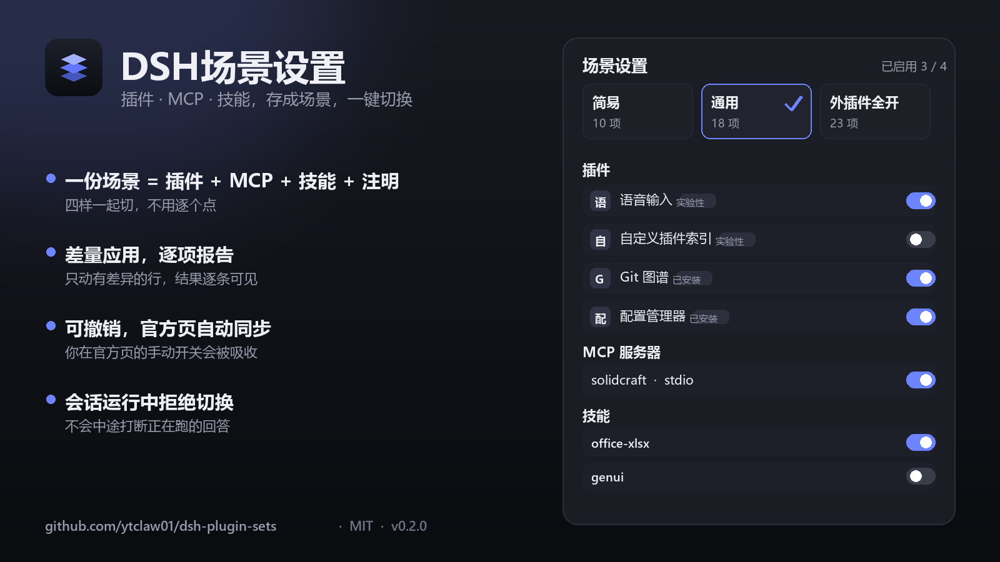
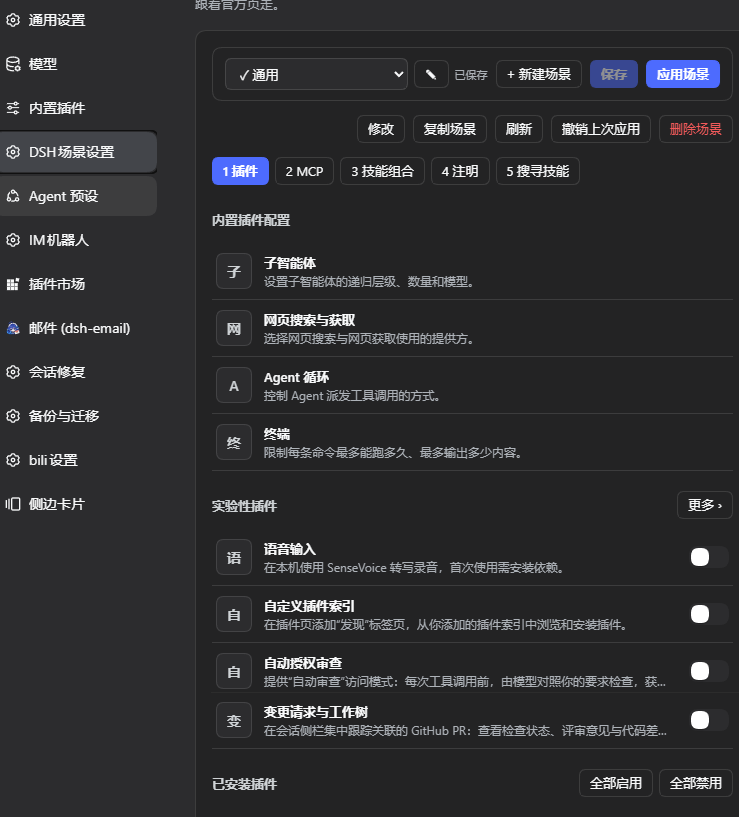
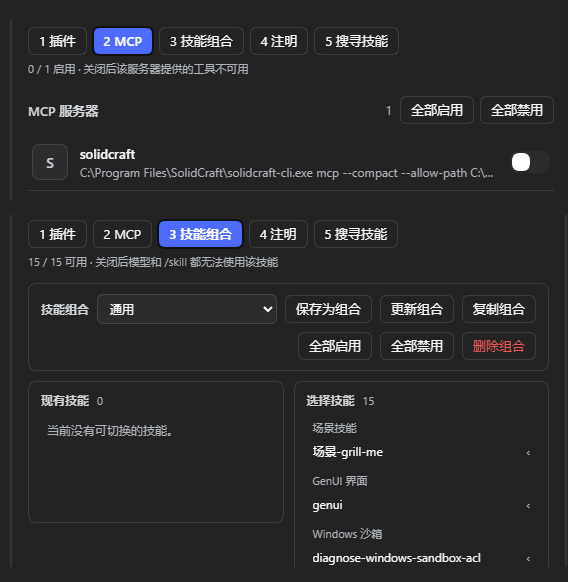
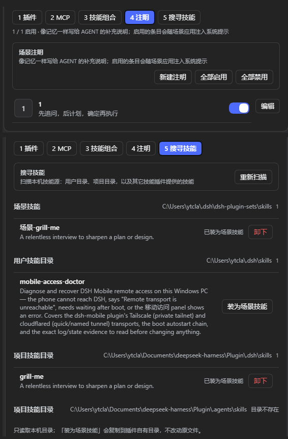

# DSH场景设置 · dsh-plugin-sets

把官方「插件」页的启用状态存成一份份**场景**，一键切换；同一份场景里还带着 **MCP 服务器**、**技能开关**与**场景注明**。

A DSH plugin that saves the official Plugins page state as named **scenes** — plugin bundles, MCP servers, skill switches and written scene notes together — and switches between them in one click.

- 插件包 / bundle: `dsh-plugin-sets`
- 入口 / entry: 设置 → **DSH场景设置**（`Settings → DSH scene settings`）
- 需要 / requires: DSH 桌面版或 Web 版（`dsh.bundle` + `dsh.client`），在 `@deepseek-ai/dsh-desktop-runtime` 0.2.2-rc.3 上验证



| 插件页 | MCP 与技能组合 | 注明与搜寻技能 |
| --- | --- | --- |
|  |  |  |

---

## 中文

### 它做什么

一个场景 = 四样东西的快照：

1. **插件**：官方「插件」页里那些带开关的 bundle（内置插件配置 / 实验性插件 / 已安装插件，布局和顺序都照官方页来，包括「更多」展开和被官方隐藏的条目）
2. **MCP 服务器**：`@deepseek-ai/dsh-mcp-client` 那几行（例如 SolidCraft），可以单独开关
3. **技能**：把某些技能**彻底停用**——不是藏起来，而是让模型和 `/skill` 都拿不到；技能页按来源分组（场景技能 / Univer 办公 / GenUI 界面 / Windows 沙箱 / 本地技能），可以编成可复用的**技能组合**
4. **注明**：像写记忆一样写给 AGENT 的补充说明，按条目开关，随场景一起应用并注入系统提示

应用一个场景做的是**差量**：只改和当前状态不一致的那几行，逐项执行并逐项报告结果。

### 主要功能

- **场景下拉**：顶部下拉直接切换场景，场景多了自动可滚动；旁边是保存 / 新建 / 修改 / 复制 / 刷新 / 撤销 / 删除
- **输入框快捷键**：新会话的输入框左侧有场景 chip，点开即选即应用
- **五步编辑**：`1 插件` → `2 MCP` → `3 技能组合` → `4 注明` → `5 搜寻技能`
- **技能组合**：把一批技能的开关存成命名组合（保存 / 更新 / 复制 / 删除），场景引用组合，组合本身也随场景一起应用
- **搜寻技能**：扫描本机技能源（用户目录、项目目录、其它技能插件提供的技能），可把某个技能「装为场景技能」（复制到本插件自己的目录并以 `场景-` 前缀登记，不动原文件），随时「卸下」
- **撤销上次应用**：把最近一次应用前的 bundle、MCP、技能、注明状态整体还原
- **跟随官方页**：激活中的场景会一直跟官方页保持一致——你在官方页手动开关某行，这个改动会被吸进当前场景，两边不打架
- **会话保护**：只要有会话正在跑（回合未结束），应用与撤销会被拒绝并提示，避免在回答中途把工具换掉
- **需要重启时给选择**：某项改动必须重启 DSH 才生效时，可以「继续应用」或「停在这里」，之后再手动重启
- **中英跟随**：界面语言跟随 DSH 自己的语言设置，不另设开关

### 安装

三种方式任选：

1. **插件市场**：设置 → 插件市场 → 搜索 `dsh-plugin-sets`
2. **命令行**：
   ```sh
   dsh plugin add github:ytclaw01/dsh-plugin-sets
   ```
   同一个包也发布在 npm（同名，当前 `0.2.0`），可用 `npm i dsh-plugin-sets` 获取源码或做版本校验；DSH 内的安装与启用仍建议用上面的 GitHub 地址
3. **从源码**：`Settings → 插件 → 添加插件`，填本仓库地址；或本地目录用 `plugin_manager install_bundle`

安装后到 **设置 → DSH场景设置**。

### 使用

1. 「＋新建场景」→ 第 1 步「插件」挑 bundle → 第 2 步「MCP」挑服务器 → 第 3 步「技能组合」关掉不需要的技能（可存成组合）→ 第 4 步「注明」勾选要带上的说明
2. 「保存」→ 在顶部下拉选中该场景，点「应用场景」，确认差量后执行
3. 日常切换：输入框左侧 chip 直接选；或右键场景「应用场景」

### 数据与安全

- 唯一的持久化数据：`<DSH_HOME>/dsh-plugin-sets/scenes.json`（默认 `~/.dsh/dsh-plugin-sets/scenes.json`），原子写入
- 只提供本机回环接口 `/api/plugin-sets/*`，带同源 JSON 校验；不监听外网端口
- 改插件状态走 DSH 官方 `pluginManager`（写 profile 的 patch 覆盖），**不修改任何第三方插件文件**
- 停用技能用的是「影子 provider」：以更低的 `rank` 重新登记同名技能并把 `modelInvocable` / `userInvocable` 置为 false；技能本体仍在磁盘上
- 无遥测、无外发请求、不需要任何 API key

### 已知限制

- 技能掩码依赖本插件的 host 半常驻：**本插件崩溃时掩码会失效，被停用的技能会重新可用**（fail-open，偏向「不会把技能永久搞坏」）
- 如果同时装了别的技能管理插件（例如 `@michengai/dsh-skills-manager`），两边都能改同一批技能；本插件用 `rank: 0` 优先，所以另一页的开关可能在视觉上「不生效」
- 只有 web UI 有设置页（`dsh.client.platform: web`）

### 贡献

欢迎 issue / PR。代码结构很简单：

- `index.js` — host 半：路由、场景存储、差量应用、技能影子 provider、会话运行检测
- `client.js` — client 半：设置页与输入框 chip（纯 React，不依赖 DSH 的客户端包）
- `cordis.patch.yml` — 让 DSH 装上它的 loader patch

---

## English

### What it does

A scene is a snapshot of four things:

1. **Plugins** — the same bundle rows the official Plugins page shows (builtin config / experimental with its “More” list / installed, same grouping and ordering)
2. **MCP servers** — rows of `@deepseek-ai/dsh-mcp-client`, switchable per server
3. **Skills** — skills that are **truly unusable**: neither the model nor `/skill` can resolve them; the skills page groups them by source (scene skills / Univer / GenUI / Windows sandbox / local) and lets you save reusable **skill combos**
4. **Notes** — written instructions for the agent, like memory; enabled notes ride along with the scene and are injected into the system prompt

Applying a scene is a **diff**: only rows that differ from the live state are touched, one by one, each with its own result.

### Features

- A scene dropdown at the top (scrolls once you have many), with save / new / edit / duplicate / refresh / undo / delete beside it
- A composer chip that applies a scene before the first message
- Five editing steps: `1 Plugins` → `2 MCP` → `3 Skill combos` → `4 Notes` → `5 Discover skills`
- Skill combos: save a named set of skill switches, reuse it in scenes; the combo applies together with its scene
- Discover skills: scans local sources (user dir, project dir, skills served by other skill plugins) and can adopt one as a scene skill (copied into this plugin's own folder and registered with a `scene-` name; the original is never touched), removable at any time
- Undo the last apply (plugins, MCP, skills and notes restored together)
- The active scene stays identical to the official page: manual toggles there are absorbed into it
- Applies are refused while any chat is running, so a running answer never loses its tools mid-step
- When a change needs a DSH restart you choose: continue applying, or stop here
- UI language follows DSH's own locale setting; no separate toggle

### Install

```sh
dsh plugin add github:ytclaw01/dsh-plugin-sets
```

The same package is also published to npm under the same name (currently `0.2.0`) for source access and version checks (`npm i dsh-plugin-sets`); installing inside DSH is still best done from the GitHub address above.

Alternatively install it from the plugin market, or point `Settings → Plugins → Add plugin` at this repository. Then open `Settings → DSH scene settings`.

### Data and safety

- The only persistent state is `<DSH_HOME>/dsh-plugin-sets/scenes.json`, written atomically
- Loopback-only HTTP routes (`/api/plugin-sets/*`) with same-origin JSON checks; nothing is exposed to the network
- Plugin state is changed through DSH's own `pluginManager` (profile patch overrides); **no third-party plugin files are ever modified**
- Disabled skills are masked by a shadow provider (`modelInvocable: false`, `userInvocable: false`, `rank: 0`); the skill files stay on disk
- No telemetry, no outbound requests, no API keys

### Known limitations

- The skill mask lives in this plugin's host half: if it crashes, masks disappear and the skills become usable again (fail-open)
- If another skill manager (e.g. `@michengai/dsh-skills-manager`) is installed, both can toggle the same skills; this plugin wins with `rank: 0`, which can make the other page's switch look ineffective
- The settings page is web-only (`dsh.client.platform: web`)

### Contributing

Issues and pull requests are welcome. Layout:

- `index.js` — host half: routes, scene store, diff apply, skill shadow provider, running-session guard
- `client.js` — client half: settings page and composer chip (plain React, no DSH client packages)
- `cordis.patch.yml` — loader patch that installs it

---

## 致谢 / Thanks

欢迎其他用户一起共同完善此插件。我可以添加协同维护者或者捐赠给开源组织，谢谢。

Contributions are welcome — I'm happy to add co-maintainers or donate this project to an open-source organization. Thank you.

## License

MIT
